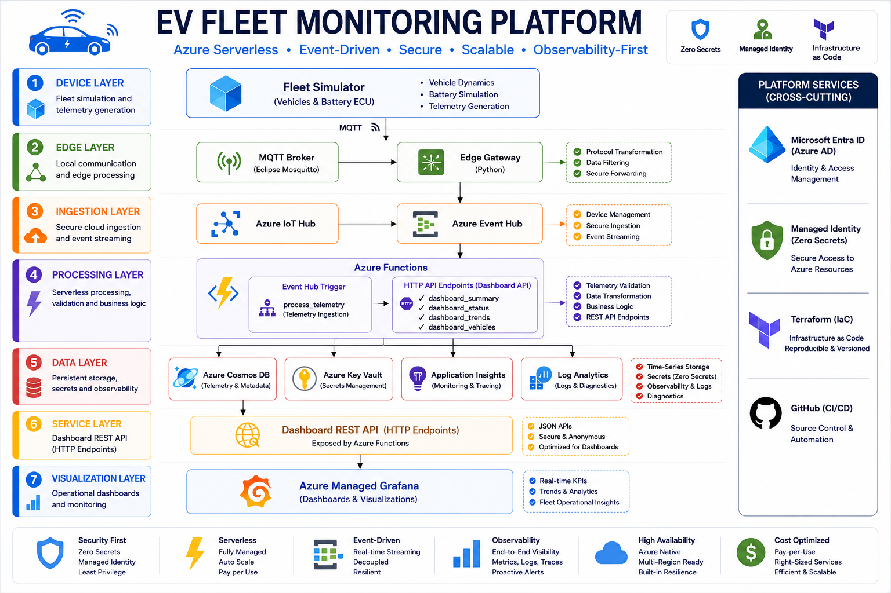
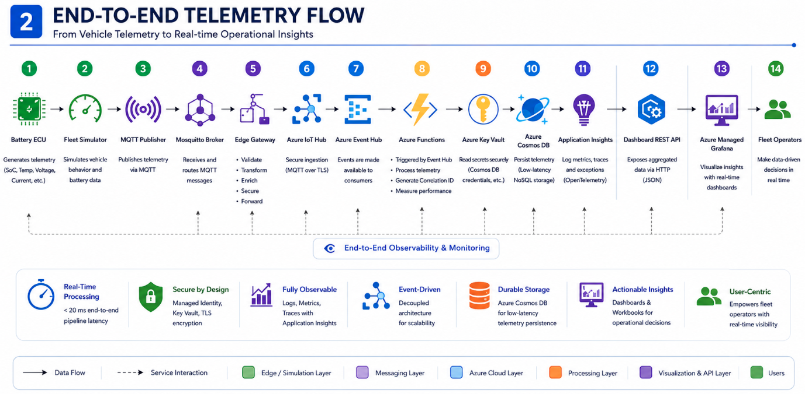
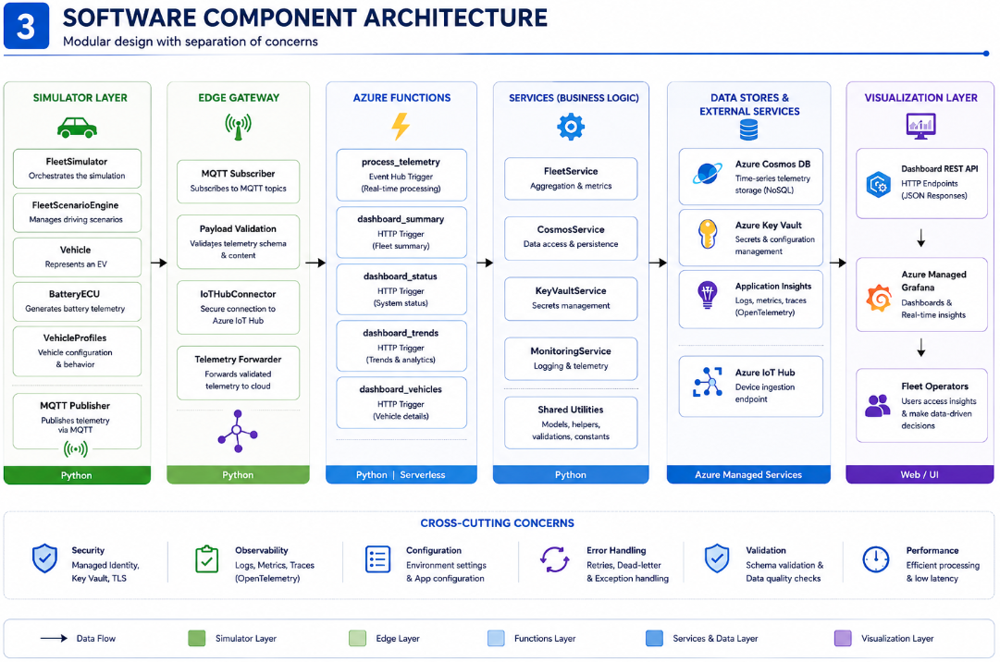
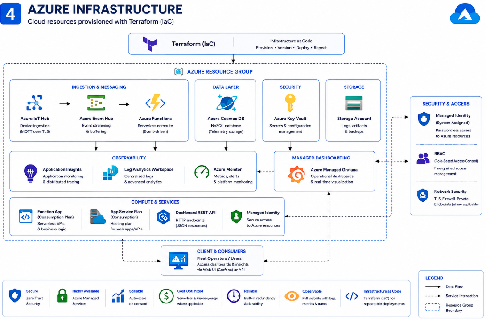

# EV Fleet Monitoring Platform

An end-to-end Azure IoT reference platform for collecting, processing,
storing, and visualizing telemetry from a simulated electric vehicle
fleet.

The project demonstrates how vehicle and battery data move from a
device-side simulation through an edge layer into Azure, where events
are processed and made available for fleet monitoring.

## Project Overview

The platform simulates multiple electric vehicles and their battery
telemetry. It provides a complete path from telemetry generation to
operational dashboards.

The main objectives are to:

- Model vehicle and battery telemetry using configurable driving
  scenarios.
- Transfer telemetry through MQTT and an edge gateway.
- Ingest device messages into Azure IoT Hub.
- Process incoming events with Azure Functions.
- Persist telemetry in Azure Cosmos DB.
- Expose fleet information through REST APIs and visualize it in
  Grafana.
- Provision cloud infrastructure with Terraform and monitor the platform
  with Azure monitoring services.

## Architecture

The diagrams below describe the platform from four complementary
perspectives: overall solution, telemetry flow, software components, and
deployed Azure infrastructure.

### 1. Executive Architecture

High-level view of the platform layers and their main interactions.

<figure>

<figcaption aria-hidden="true">Executive architecture</figcaption>
</figure>

### 2. End-to-End Telemetry Flow

The telemetry flow from the simulated Battery ECU to the fleet operator
dashboard.

<figure>

<figcaption aria-hidden="true">End-to-end telemetry flow</figcaption>
</figure>

### 3. Software Component Architecture

The main software modules and their responsibilities, including the
simulator, Edge Gateway, Azure Functions, backend services, data
services, and visualization layer.

<figure>

<figcaption aria-hidden="true">Software component
architecture</figcaption>
</figure>

### 4. Azure Infrastructure

The Azure resources provisioned through Terraform and the main
relationships between compute, ingestion, storage, security, monitoring,
and dashboard services.

<figure>

<figcaption aria-hidden="true">Azure infrastructure</figcaption>
</figure>

## End-to-End Processing

| Stage         | Component                                 | Responsibility                                                                                         |
|---------------|-------------------------------------------|--------------------------------------------------------------------------------------------------------|
| 1\. Generate  | Fleet Simulator                           | Simulates vehicles and produces battery and vehicle telemetry.                                         |
| 2\. Publish   | MQTT Broker                               | Receives and distributes telemetry messages from publishers to subscribers.                            |
| 3\. Prepare   | Edge Gateway                              | Validates and prepares incoming telemetry before forwarding it to Azure.                               |
| 4\. Ingest    | Azure IoT Hub                             | Provides the cloud entry point for device telemetry.                                                   |
| 5\. Process   | Azure Functions                           | Consumes events from the IoT Hub Event Hubs-compatible endpoint and coordinates telemetry persistence. |
| 6\. Store     | Azure Cosmos DB                           | Persists telemetry for subsequent queries and dashboard use.                                           |
| 7\. Serve     | FleetService and HTTP-triggered Functions | Retrieves and prepares fleet summaries, vehicle information, trends, and status data.                  |
| 8\. Visualize | Azure Managed Grafana                     | Displays fleet information through operational dashboards.                                             |

## Main Components

### Fleet Simulator

The simulator represents a fleet of electric vehicles. It generates
telemetry such as:

- Battery state of charge (SoC)
- Battery temperature
- Voltage and current
- Vehicle and battery operating state

Configurable scenarios represent different vehicle operating conditions,
including driving, charging, and parked states.

### MQTT Broker and Edge Gateway

The MQTT broker provides the messaging layer between telemetry producers
and the Edge Gateway.

The Edge Gateway is an application-level component. It validates and
prepares incoming messages before forwarding them to Azure IoT Hub. It
represents the edge processing role in the reference architecture; it is
not intended to model one specific vehicle ECU or hardware gateway.

### Azure Cloud Backend

The cloud backend is implemented with Azure Functions and Cosmos DB.

- **Azure IoT Hub** receives telemetry from the edge layer.
- **Azure Functions** processes incoming events using an Event Hub
  trigger.
- **CosmosService** handles persistence and data access to Cosmos DB.
- **FleetService** contains dashboard-oriented business logic. It
  prepares fleet summaries, vehicle views, trends, and status
  information.
- **HTTP-triggered Functions** expose the prepared data through REST
  endpoints.

### Dashboard API

The backend exposes the following dashboard endpoints:

| Endpoint                      | Purpose                          |
|-------------------------------|----------------------------------|
| `GET /api/dashboard/summary`  | Fleet-level summary information. |
| `GET /api/dashboard/vehicles` | Vehicle-level information.       |
| `GET /api/dashboard/trends`   | Historical and trend data.       |
| `GET /api/dashboard/status`   | Fleet status information.        |

The exact route prefix depends on the Azure Functions host
configuration.

Grafana consumes the API data to present fleet status, vehicle
information, and telemetry trends.

## Security and Operations

Security and operational visibility are part of the platform design.

- **Managed Identity** is used where configured to authenticate the
  application to Azure resources without embedding application
  credentials in source code.
- **Azure Key Vault** provides centralized secret storage for
  application secrets.
- **Azure Monitor, Application Insights, and Log Analytics** support
  platform monitoring, application diagnostics, and log analysis.
- **Correlation IDs and processing-duration measurements** are included
  in telemetry-processing logs to support troubleshooting.

Managed Identity establishes the applications identity. Azure role
assignments and resource permissions determine which resources that
identity can access.

## Infrastructure as Code

Terraform is used to define and provision the Azure infrastructure in
modular configurations.

The deployed infrastructure includes the platforms Azure resources,
such as:

- Azure IoT Hub
- Azure Event Hub
- Azure Functions and supporting storage
- Azure Cosmos DB
- Azure Key Vault
- Application Insights
- Log Analytics
- Azure Managed Grafana

Infrastructure definitions are version-controlled alongside the
application code. This supports repeatable provisioning and review of
infrastructure changes.

## Technology Stack

| Area              | Technologies                                       |
|-------------------|----------------------------------------------------|
| Language          | Python 3.11                                        |
| Device messaging  | MQTT, Eclipse Mosquitto                            |
| IoT ingestion     | Azure IoT Hub                                      |
| Event processing  | Azure Functions, Event Hub trigger                 |
| Data storage      | Azure Cosmos DB                                    |
| Backend interface | HTTP APIs, REST, JSON                              |
| Security          | Managed Identity, Azure Key Vault                  |
| Monitoring        | Azure Monitor, Application Insights, Log Analytics |
| Visualization     | Azure Managed Grafana                              |
| Infrastructure    | Terraform                                          |
| CI/CD             | GitHub Actions                                     |
| Development       | Git, GitHub, Visual Studio Code                    |

## Repository Structure

``` text
EV-Fleet-Monitoring-Platform/
├── cloud/
│   ├── function_app/
│   ├── services/
│   └── requirements.txt
├── edge/
│   ├── gateway/
│   └── mqtt/
├── simulator/
│   ├── battery_ecu.py
│   ├── vehicle.py
│   ├── fleet_scenario_engine.py
│   ├── fleet_simulator.py
│   └── vehicle_profiles.py
├── grafana/
│   ├── dashboard.json
│   └── README.md
├── infrastructure/
│   ├── modules/
│   └── environments/
├── docs/
│   ├── diagrams/
│   │   ├── 01-executive-architecture.png
│   │   ├── 02-telemetry-flow.png
│   │   ├── 03-software-components.png
│   │   └── 04-azure-infrastructure.png
│   └── screenshots/
└── README.md
```

## Project Scope

This is a reference implementation built around simulated vehicle data.
It demonstrates the integration of device messaging, edge processing,
cloud ingestion, event-driven backend processing, data persistence,
APIs, and dashboards.

The simulator and Edge Gateway simplify the vehicle-side environment.
They do not represent a production vehicle network in full. In a real
vehicle, communication between ECUs would typically use automotive
networks and protocols such as CAN/CAN-FD and Automotive Ethernet. MQTT
is used here for telemetry messaging in the prototype architecture, not
as a replacement for those in-vehicle protocols.

The platform demonstrates architectural integration and engineering
practices. A production deployment would require environment-specific
decisions for identity and access management, network design,
resilience, capacity, data retention, and operational security.

## Author

**Ibrahim Ndah**
Azure Cloud Architecture | Enterprise Platforms | Industrial IoT

[LinkedIn](https://www.linkedin.com/in/ibrahim-ndah)
